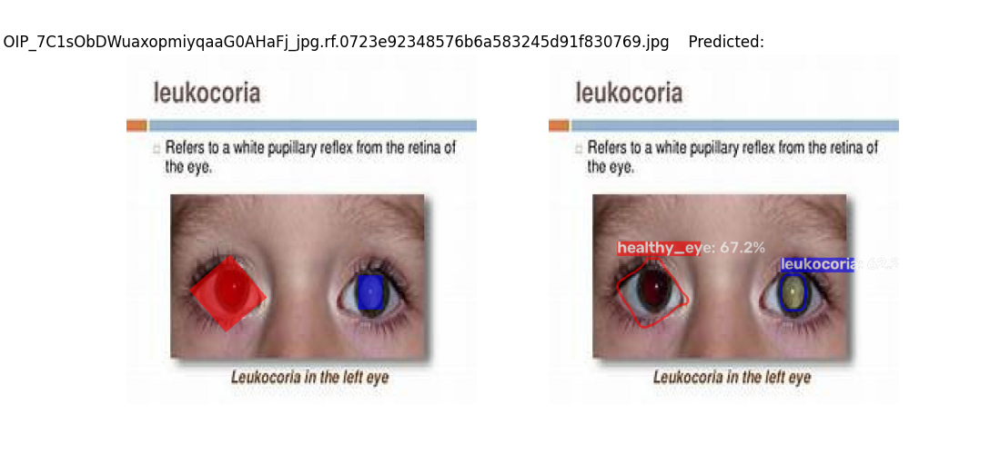
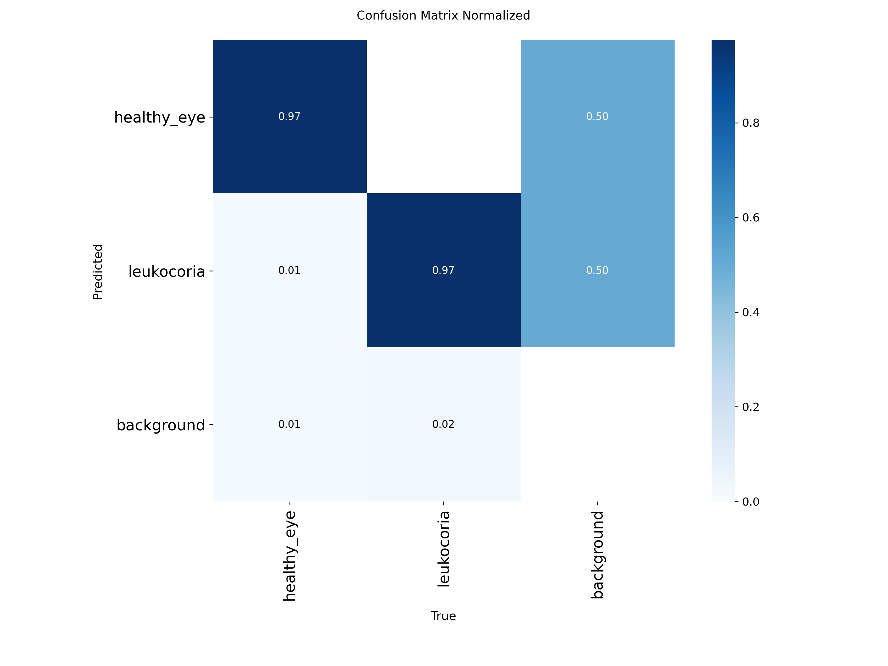

# Detect_Leukocoria_Yolo26-seg

Development and testing of a model to detect the clinical ophthalmological sign known as "leukocoria," trained using YOLO26-seg on a dataset from Roboflow: https://universe.roboflow.com/leukocoria-detector-nv8ij/leukocoria-detector-rsl8x/dataset/2

INTRODUCTION
====================================================================

According to Google:

Leukocoria (commonly known as "white pupil" or "amaurotic cat's eye") is a clinical sign characterized by the appearance of a white reflection or spot in the pupil, rather than the normal reddish or orange reflection that occurs when light hits the back of the eye.

What causes it?

This sign appears when there is an opacity or an alteration in the internal structures of the eye (from the cornea to the retina) that prevents light from reflecting in the usual way:

• Retinoblastoma: A malignant intraocular tumor that is very common in childhood; it accounts for nearly 50% of leukocoria cases in children.

• Congenital cataracts: An opacity of the lens present from birth.

• Persistent fetal vasculature (or primary hyperplastic vitreous): A failure in the regression of the eye's fetal blood vessels.

• Coats' disease: An abnormality in the retinal blood vessels that leads to exudation and retinal detachment.

• Retinopathy of prematurity (ROP): An alteration in the growth of retinal blood vessels in premature infants.

• Other causes: Ocular toxoplasmosis, toxocariasis, retinal detachment, or optic nerve abnormalities.

How it is detected

• Flash photography: It is often first noticed in photographs (appearing as a white, grayish, or yellowish reflection in one eye, or as an asymmetry compared to the other eye). • Pediatric examination: This is assessed using the red reflex test during routine child health check-ups.

What to do

Leukocoria is a medical red flag that requires an urgent evaluation by a pediatric ophthalmologist. Early diagnosis and treatment are essential for protecting vision and—in cases such as tumors—saving the patient’s life.

As stated in the article:

Building RETINA-AI: From a CNN Training Pipeline to a Retinoblastoma Screening App | by Moch Yahya | Oct, 2026 | Medium
https://medium.com/@mochammadyahya002/building-retina-ai-from-a-cnn-training-pipeline-to-a-retinoblastoma-screening-app-81379067c0cd

Retinoblastoma is the most common eye cancer in children under five (roughly 1 case per 15,000–20,000 live births). Its early sign is often visible to the naked eye: leukocoria, a white reflection in the pupil—resembling a “cat’s eye”—that appears in flash photographs. In Indonesia, many patients reach a referral facility only at an advanced stage because specialists and imaging equipment are unevenly distributed. Leveraging an existing Roboflow dataset for this ophthalmological sign:

Leukocoria Detector - v2 leukocoria-version-2
https://universe.roboflow.com/leukocoria-detector-nv8ij/leukocoria-detector-rsl8x/dataset/2

For detection:
Leukocoria Detector Model > Overview
https://universe.roboflow.com/leukocoria-detector-nv8ij/leukocoria-detector-rsl8x

And building upon the acceptable results obtained in a previous project that utilized `yolo26-seg`:

ablanco1950/BrainTumorsSegmentation_yolo26: Brain tumor segmentation using `yolo26-seg` and the Roboflow dataset: https://universe.roboflow.com/mri-brain-tumor/brain-tumor-segmentation-8aek5/dataset/1
https://github.com/ablanco1950/BrainTumorsSegmentation_yolo26

This project, which employs `yolo26-seg`, is presented here.

===============================================

INSTALLATION

Download and extract the project folder.

Download the dataset from: https://universe.roboflow.com/leukocoria-detector-nv8ij/leukocoria-detector-rsl8x/dataset/2

You will need a Roboflow API key, which can be obtained for free on the Roboflow website.

You can choose the option to download the dataset as a ZIP file, move it to the project folder, and extract it there. You may be prompted to overwrite existing files—this is because the `data.yaml` file appears twice in the Roboflow dataset; please proceed with the overwrite.

Regarding the required modules, a `requirements.txt` file is provided.

In a new environment, you simply need to install the latest version of `ultralytics`:

pip install ultralytics

================================================

TEST

`python TestLeukocoriaSegmentation_yolo26.py`

The 37 images from the file `Leukocoria Detector.v2-leukocoria-version-2.yolov8-obb\test\images` are displayed one by one. On the right side of the screen, the image appears with labels identifying the eye as either healthy (in red) or affected by leukocoria (in blue)—these are assumed to be the correct classifications. On the right, the image is displayed, indicating whether the eyes are predicted to be healthy or to have leukocoria.

The console output also specifies, for each image and each eye, whether it is labeled as healthy (in red) or as having leukocoria (in blue).

Testing  37 images from the folder Leukocoria Detector.v2-leukocoria-version-2.yolov8-obb\\test only errors in:

64_png.rf.f358f66d074eb0881c3aa9928739d67f.jpg

image_295_png.rf.8b08082f95cf4b4760376373643b3ba7.jpg

OIP_-_-QNAiEQ0e9z0tP0D6WFAHaHA_jpg.rf.92e28366c7c24f32e342db595ffffa6e.jpg

=================================================
TRAINING

The model used for testing:`best.pt`, was obtained by executing:

python TrainLeukocoriaSegmentation_yolo26.py

The training process was configured and adapted to run on a personal computer equipped with a CPU (no GPU) and 16 GB of RAM. This setup allowed for daily tasks and other applications to continue running while the model was being trained over 200 epochs.

During training, intermediate model files—`best.pt` and `last.pt`—are saved to the directory `runs\segment\entrenamientos_yolo26\segmentacion_custom\weights`, which is created automatically.

A compressed folder, `segmentacion_custom.zip`, is attached; it contains the training results, including the confusion matrix.

================================================

REFERENCES

https://universe.roboflow.com/leukocoria-detector-nv8ij/leukocoria-detector-rsl8x/dataset/2

https://github.com/ablanco1950/BrainTumorsSegmentation_yolo26

https://medium.com/@mochammadyahya002/building-retina-ai-from-a-cnn-training-pipeline-to-a-retinoblastoma-screening-app-81379067c0cd)
